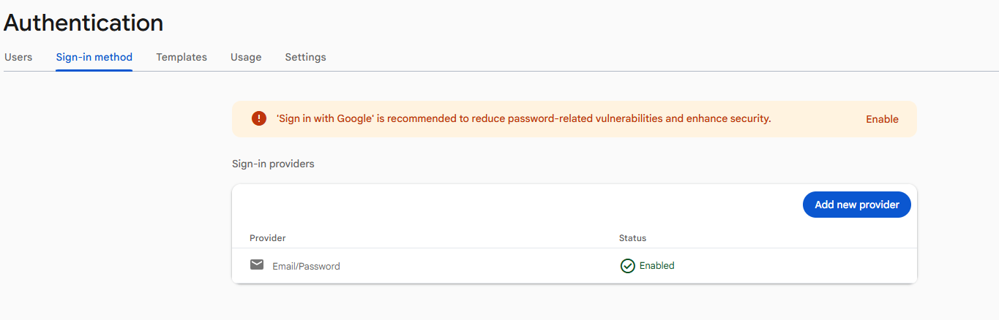

# Important - Enable Login with Username and Password
Before completing this week's lab sign in to firebase.google.com. Find your project and under Authententication (click get started if it's your first time on this screen) - then Sign In Method - Enable Sign in with Username and Password

Product categories --> Security --> Authentication --> Get Started

# Login App

- This app builds on the previous google firebase app and uses firebase to register and login
- The App has multiple Screens

  # Step 1

  Get the app to work. Modify the settings in firebase.js using the settings from last week and get the app to register and authenticate users

  # Step 2

  Add an additional screen to the app that captures some info and records the data to firebase - this can be to a new collection of your choosing. Make sure there are at least two fields.

  

  
